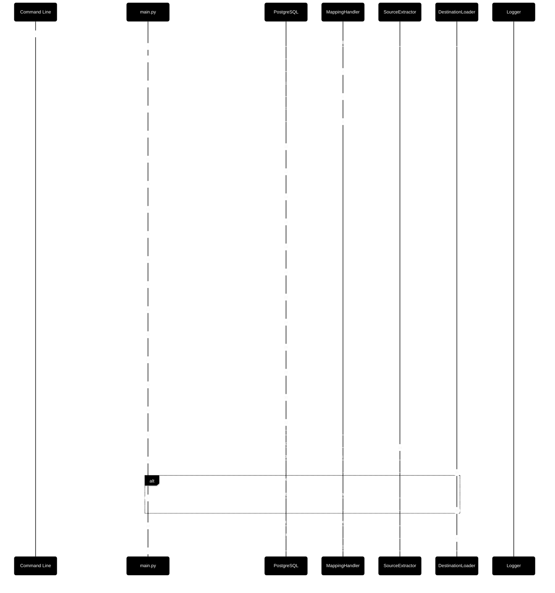

# Cross-Platform ETL Pipeline: SQL Server to PostgreSQL Migration

<div align="center">

[](https://www.python.org/) [](https://learn.microsoft.com/en-us/sql/sql-server/what-s-new-in-sql-server-2022?view=sql-server-ver17) [](https://www.postgresql.org/) [](https://pdm.fming.dev)
</div>

This repository contains a modular ETL orchestration pipeline from SQL Server to  PostgreSQL databases. It automates the full lifecycle of database teardown, schema creation, query mapping generation, data extraction, and data loading into production and test environments.

## 🪄 Overview

The ETL workflow is coordinated through a single entry point (`main.py`) and integrates reusable modules for:

- Pre-flight validation of the mapping and every SQL script — before anything is dropped
- Dropping and rebuilding PostgreSQL databases (the ETL role is created or updated, never dropped)
- Generating source and destination query mappings from a CSV file
- Extracting source data using parameterized SQL SELECT queries
- Loading extracted data into destination tables using INSERT queries
- Optionally seeding a test database with the same data
- Reconciling source and destination row counts after the load

> ⚠️ The pipeline **drops and recreates** the target database and its `_test` clone.

## 🚀 Quick start

```bash
# 1. Install (Python 3.10+)
pip install -r requirements.txt          # or: pdm install

# 2. Configure
cp .env.example .env                     # then edit connection settings

# 3. (Optional) local PostgreSQL destination
docker compose up -d

# 4. Check the mapping and SQL scripts without touching any database
python src/main.py --database aw_sales --validate-only

# 5. Run the ETL
python src/main.py --database aw_sales --seed-test-database false
```

| Option | Description |
|---|---|
| `-d`, `--database` | Target PostgreSQL database (letters, digits, underscores) |
| `-s`, `--seed-test-database` | Also load `<database>_test` — `true`/`false`, default `false` |
| `--validate-only` | Pre-flight checks + mapping generation only; no database changes |
| `--skip-verify` | Skip the source/destination row-count reconciliation |

Paths default to locations inside the repository, so the same `.env` works on
Windows, Linux, macOS, Docker and CI. See [`.env.example`](./.env.example) for
every setting.

The ETL pipeline processes data across 35 distinct tables, resulting in a total of 485,625 rows extracted, transformed, and loaded into the destination system. The volume reflects a moderately complex schema with substantial row-level operations, suitable for analytics, reporting, or downstream integration.

|Stat|Count|
|---|---|
|Total Number of Tables|35|
|Total Number of Rows|485,625|




## 📦 Packages

| Domain            | Package           | Minimum Version |
|------------------|-------------------|-----------------|
| Database Drivers | psycopg2-binary   | 2.9.10          |
|                  | pyodbc            | 5.2.0           |
| Environment      | python-dotenv     | 1.1.1           |
| Data Processing  | pandas            | 2.2             |
| Dev / Test       | pytest, ruff, black | see `pyproject.toml` |
| Docs             | sphinx, sphinx-rtd-theme | see `pyproject.toml` |

## 🧩 Modular Components

Each stage of the pipeline is modular and testable:

- `create_database()`: Creates PostgreSQL databases
- `create_role()`: Creates database roles
- `grant_database_permissions()`: Grants database-level access
- `create_database_schemas()`: Creates schemas
- `create_database_tables()`: Creates tables from SQL files
- `extract_source_data()`: Extracts data from source queries
- `load_destination_tables()`: Loads data into destination tables
- `build_mapping_data()`: Generates query/table mappings from CSV
- `validate_mapping()`: Pre-flight checks — missing scripts, INSERT/SELECT column counts, foreign-key load order
- `verify_row_counts()`: Source vs destination row-count reconciliation

## 📦 Repository Structure

```text
├── sql/                                   # SQL scripts and mappings
│   ├── source/
│   ├── destination/
│   ├── mapping.csv                        # Source-to-destination table/query mapping
│   ├── mapping_source.json                # Generated source query mappings
│   └── mapping_destination.json           # Generated destination query mappings
├── logs/                                  # Runtime logging
│   └── app.log                            # Application log output
├── src/
│   ├── build/
│   │   └── build_destination_database.py  # PostgreSQL DDL and permission utilities
│   ├── extract/
│   │   └── get_source_data.py            # Source data extraction logic
│   ├── load/
│   │   └── insert_source_data.py         # Destination data insertion logic
│   ├── utils/
│   │   ├── file_handler.py               # JSON and SQL file utilities
│   │   ├── logging_handler.py            # Structured logging
│   │   ├── query_mapping_handler.py      # Mapping generation from CSV
│   │   └── validation_handler.py         # Pre-flight mapping validation
│   ├── config.py                         # Settings and cross-platform paths
│   └── main.py                           # ETL orchestration entry point
├── tests/                                # Unit tests (+ integration/ for PostgreSQL)
├── docker-compose.yml                    # Local PostgreSQL destination
└── .github/workflows/ci.yml              # Lint, tests, validation, integration
```

## 🧪 Testing

```bash
pip install -r requirements-dev.txt
pytest                                    # unit tests, no database needed
ruff check src tests

# Full pipeline against a throwaway PostgreSQL (drops/creates etl_ci + role):
ETL_PG_INTEGRATION=1 pytest tests/integration
```

CI runs all of the above on Python 3.10, 3.12 and 3.13 with a PostgreSQL 16
service. See [CHANGELOG.md](./CHANGELOG.md) for the bugs fixed in 0.2.0.

## ✅ Logging

Structured logging is enabled throughout the pipeline for traceability:

- Success and failure messages for each stage
- Exception handling with stack traces
- Visual markers for pipeline progress

Example: [app.log](./logs/app.log)

## 🤝 Contributing

This project welcomes modular enhancements, teardown logic improvements, and onboarding clarity. Please submit pull requests with:

- Isolated, testable changes
- Updated docstrings and logging
- Contributor-friendly scaffolds

## 🙏 Credits

Originally created by [Kimberly Emerson](https://github.com/kimberly-emerson/python-etl-sql-postgres).
This repository contains bug fixes and enhancements on top of that work — see
[CHANGELOG.md](./CHANGELOG.md).

## 📄 License

This repository is licensed under the MIT License. See `LICENSE` for details.
